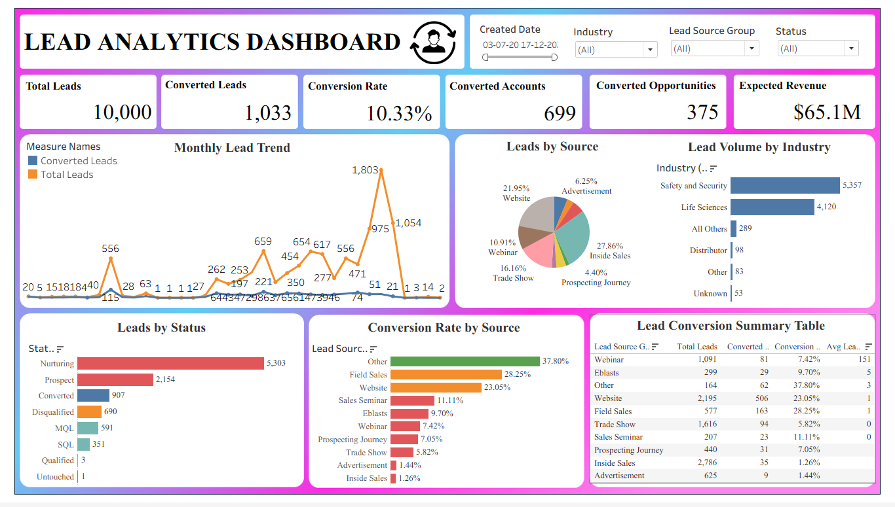
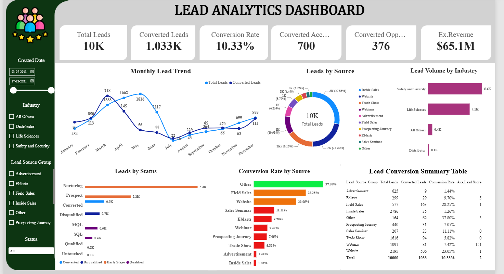

# CRM Lead Analytics Dashboard (SQL, Tableau, Power BI)

An end-to-end lead analytics project on a Salesforce CRM dataset of **10,000 leads** (July 2013 to December 2021). I cleaned the data and wrote the KPI queries in **MySQL**, then built the same Lead Analytics dashboard in **Tableau** and **Power BI**.

This was a group project during the ExcelR Business Analytics course. This repository contains my part: the SQL work and the Lead dashboards.

## Business question

Where do our leads come from, how many of them convert, and which sources and industries deserve attention?

## Tools

MySQL 8 (CTEs, window functions, views) | Tableau Public | Power BI Desktop (DAX)

## Dashboard preview





## What the dashboard shows

**8 KPIs:** Total Leads, Converted Leads, Lead Conversion Rate, Converted Accounts, Converted Opportunities, Expected Revenue (Converted), Avg Lead Score, Avg Age of Open Leads.

**6 visuals:** monthly lead trend, leads by source, leads by status, conversion rate by source (green above 30%, amber 15 to 30%, red below 15%), lead volume by industry, and a lead conversion summary table.

**4 slicers:** date range, industry, lead source group, status. Each filter updates every card and chart together.

## Key numbers

| KPI | Value |
|---|---|
| Total Leads | 10,000 |
| Converted Leads | 1,033 |
| Lead Conversion Rate | 10.33% |
| Converted Accounts | 699 |
| Converted Opportunities | 375 |
| Expected Revenue (Converted) | $65.06M |
| Avg Lead Score | 1.56 (only 603 leads are scored) |
| Avg Age of Open Leads | 504 days (measured to 1 Jan 2022) |

## Insights

- **Inside Sales** brings the most leads (27.9%) but converts only **1.26%** of them, which makes it the biggest area for improvement.
- **Website** produced **506 of the 1,033 conversions** (49%) at a 23.05% conversion rate.
- The best conversion rates come from the small **Other** group (37.8%) and **Field Sales** (28.3%).
- More than half of all leads (5,303) are still in the **Nurturing** stage.
- **Safety and Security** and **Life Sciences** account for about 95% of all leads.
- Lead volume was low for years and peaked in **May 2021 (1,803 leads)**.

## Data cleaning done in SQL

- Converted text dates into real dates and added a year-month field for trends.
- Merged spelling variants of lead source (for example Advertisment and Advertising into Advertisement, Trades Show into Trade Show) and labelled blanks as Unknown.
- Grouped the smallest sources into Other, so charts stay readable.
- Built the converted flag from the Converted field (1,033 leads), because the Status field marks only 907 as Converted.
- Calculated the age of open leads in days.
- Counted each converted opportunity's amount only once. Counting it for every lead that converted into it would have inflated revenue from $65.06M to $70.36M.

## Data notes and limitations

- Only 603 of 10,000 leads have a lead score, so the average score is not reliable.
- The dataset has no region field, so a country filter is the closest available option.
- The source data was provided for the ExcelR course and is not included in this repository.

## Repository structure

```
sql/
  01_create_tables.sql             database and table structure (no data)
  02_lead_dashboard_queries.sql    clean lead view, 8 KPI queries, 6 chart queries
images/
  tableau_dashboard.png
  powerbi_dashboard.png
README.md
```

## How to use the SQL

1. Create the tables with `01_create_tables.sql` and load your own lead, account and opportunity data into them.
2. Run `02_lead_dashboard_queries.sql` from the top. It creates the clean view `vw_lead_clean` and then runs the KPI and chart queries.

## Author

Nitika | Business Analytics learner | [LinkedIn](https://www.linkedin.com/in/nitika-r-pal/)
